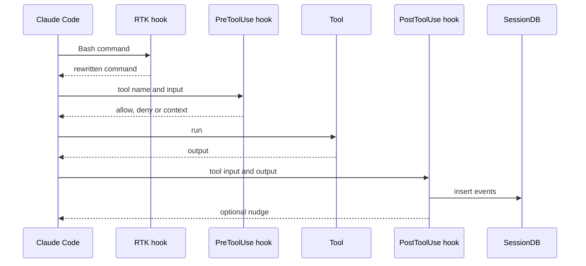

# Architecture

context-mode is two cooperating halves that share on-disk SQLite databases:

1. **The MCP server** (`start.mjs` → `server.bundle.mjs`, source `src/server.ts`) exposes the `ctx_*` tools: sandboxed execution, indexing, search, stats, doctor, upgrade, purge.
2. **The hooks** (`hooks/*.mjs`, registered by `hooks/hooks.json`) run as short-lived Node processes on Claude Code lifecycle events. They capture session events, route the model toward the sandbox tools, and inject context at session start.

The fork adds behavior only through new modules (`hooks/core/user-rules.mjs`, `subagent-tools.mjs`, `rtk.mjs`, `post-nudges.mjs`, `src/rtk-doctor.ts`, `src/util/version-compare.ts`) and small call sites in the existing files.

## Components

| Component | Location | Responsibility |
|---|---|---|
| Boot + self-heal | `start.mjs` | Resolve config dir, heal `installed_plugins.json` / hook paths, deploy the out-of-plugin cache-heal hook, then load `server.bundle.mjs` (or `build/server.js`) |
| MCP server | `src/server.ts` | Tool handlers, auto-indexing of large outputs, stats, doctor, upgrade |
| Executor | `src/executor.ts`, `src/runtime.ts` | Run code in 11 languages in a temp sandbox; only stdout returns |
| Content store | `src/store.ts` | FTS5 index (BM25 + trigram, RRF merge), chunking, search |
| Session DB | `src/session/db.ts` | Per-project event log written by hooks, read by `ctx_search` timeline and resume snapshots |
| Unified search | `src/search/unified.ts` | Merges content store, SessionDB and auto-memory for `ctx_search` |
| Security | `src/security.ts` | Evaluates the host's deny/allow rules for sandboxed commands and paths |
| Routing | `hooks/core/routing.mjs` | `routePreToolUse()`: redirects (curl/HTTP/build), WebFetch deny, Agent prompt injection, security checks |
| Formatters | `hooks/core/formatters.mjs` | Render a routing decision in each host's hook-response format |
| Adapters | `src/adapters/*` | Per-platform config paths, hook wiring, doctor checks |

## Storage

| Store | Path (Claude Code) | Lifetime |
|---|---|---|
| SessionDB | `~/.claude/context-mode/sessions/<project-hash>.db` (+ `.json` sidecars) | Persistent per project; events pruned by age, files not (see [ROADMAP](ROADMAP.md)) |
| ContentStore | `~/.claude/context-mode/content/<project-hash>.db` | Persistent per project across sessions (upstream's CONTRIBUTING still calls it ephemeral — it is not; see [PITFALLS](PITFALLS.md)) |
| Guidance counters | `$TMPDIR/context-mode-guidance-<session>/` | Per session; drive nudge cadence |

Both databases are multi-writer-safe by design ([ADR 0001](adr/0001-sessiondb-multi-writer.md)): never add file locks or exclusive locking pragmas.

## Hook lifecycle around one tool call

Constraints:

- Every hook fails open: any error means no output and exit 0, and Claude Code proceeds as if the hook were absent.
- A hook writes to stdout at most once, as its last action, and only valid JSON.
- With RTK's Bash hook registered, context-mode never returns `updatedInput` for Bash; its curl/HTTP/build redirects become `deny` with the same guidance (on Claude Code the formatter already rendered them as deny).
- PreToolUse emits no generic once-per-session advice anymore; advice comes from PostToolUse, after a Read ≥ 8 000 chars without offset/limit or a Bash output ≥ 5 000 chars, on the 1st, 6th, 11th… occurrence per session.
- Subagent (Agent tool) prompts get rules only when `subagentHasCtxTools()` says the agent can call `ctx_*`; the user's rules file replaces the built-in block when present.
- Hooks spawn no processes and read only small files; budget ~40–60 ms per invocation.

## Session start

`hooks/sessionstart.mjs` injects one rules block — `<context_mode_rules>` built from `<config dir>/context-mode-usage.md` when that file exists (≤ 64 KB), otherwise upstream's `<context_window_protection>` block — then appends resume/compact directives and snapshots from SessionDB as upstream does.

## Search

`ctx_search` in relevance mode ranks content-store chunks. In `timeline` mode it merges content store, SessionDB events and auto-memory, sorts chronologically and keeps the **most recent** `limit` entries (fork fix in `plus.3`). Content-store results are currently all labelled `"current-session"` even when indexed in an earlier session — an open issue, see [ROADMAP](ROADMAP.md).

## Upgrade and versioning

`ctx-upgrade`, the CLI `upgrade` and the "outdated" check read the fork (`PedroHenriqueNS/context-mode-plus` and its `package.json` on `main`), never upstream npm. Versions are `X.Y.Z-plus.N`; every cache-directory sort goes through `src/util/version-compare.ts`. `ctx-upgrade` updates the running version directory in place; Claude Code's `plugin update` installs a new directory and leaves the old one.
